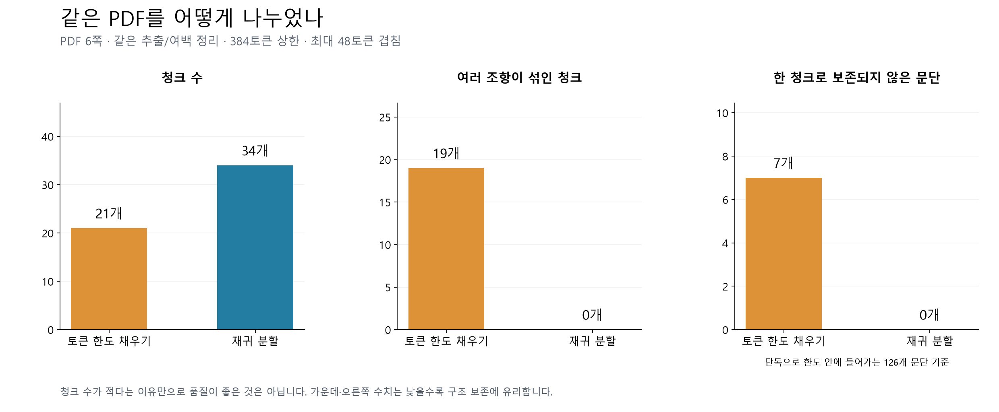
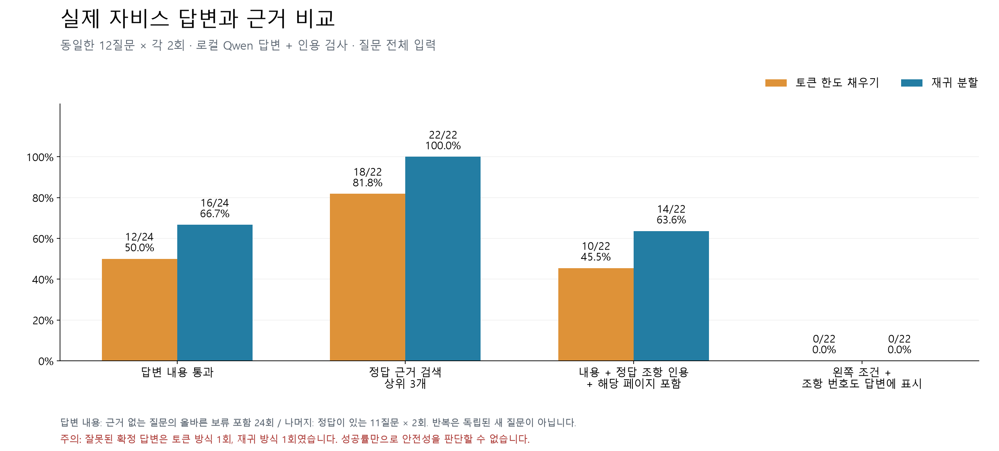
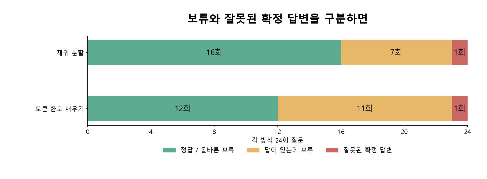

# 제공 PDF 실제 답변 및 청크 A/B 비교

2026-10-15. **이 PDF에는 재귀 청크를 유지하는 편이 유리하지만, 답변 검증과 조항 표시에는 수정이 필요하다.**
검색 성공과 올바른 최종 답변은 달랐다. 두 방식 모두 내부 검증을 통과한 오답이 1회씩 있었다.

## 시험 범위와 재현 조건

- 자료: 사용자가 제공한 건축기본법 텍스트 PDF 6쪽. 원본 SHA-256:
  `b25f8073d1ecbb1dc268f322593e444af5cdf524aa2beee2d8949206c248ce11`.
- 실제 자비스 `ChatOrchestrator → ResearchRunner → 문서 검색/재정렬 → Qwen 생성 → ground_answer` 실행.
  가짜 LLM 답변이 아니다. CLI/GUI 공통 답변 엔진의 최종 상세 출력을 검사했다. GUI 화면 클릭/음성 시험은 아니다.
- 같은 PDF의 같은 추출 Markdown, 로컬 embeddinggemma, 동일한 Cross-Encoder,
  `qwen3.5:9b` 모델, 동일한 검색·생성 예산을 사용했다. temperature=0.
- 비교용 DB 두 개에 동일 PDF만 등록했다. 기존 개발 DB·대화 기록과 제품 코드는 수정하지 않았다.
- 토큰 상한 384, 겹침 상한 48토큰; 보조 문자 상한 1200/150도 공통이다.
- 12개 질문(정답 있는 11개 + 문서에 없는 벌금액 질문 1개)을 전략별 2회, 총 48회 실행했다.
  질문마다 새 대화 세션을 사용하고 전략 실행 순서를 번갈아 배치했다. 질문은 전체를 임베딩했다.
- 이 외에 현재 재귀 경로에 “조·항 번호와 PDF 페이지를 명시해 달라”는 질문을 2개 추가했다.
  이 2개는 A/B 점수에 합산하지 않았다.

현재 `chunk_text`는 문자 수 기반 호환 함수이며 실제 문서 등록은 `document_chunks`를 사용한다.
요청한 첫 번째 비교군은 `scripts/archive/evaluations/pdf-ab-20261015/compare.py` (로컬 보관)의 `fixed_tokens`로 구현했다.
실제 모델 토큰 수를 재며 한도 가까이 채우고 문단/조항 경계는 고려하지 않는다.
원문을 연속 구간으로 자르며 한도 초과 청크는 허용하지 않는다. 토크나이저의 비단조성 때문에
수학적으로 가장 긴 모든 접두사를 찾았다는 주장은 하지 않는다.

재귀 방식은 제품의 `recursive-context-v3` 그대로다. 두 방식 모두 페이지/구조 메타데이터를 갖는다.
재귀 방식은 계층 제목을 임베딩 입력에도 사용하고 고정 방식은 파일명을 사용하므로,
**청크 경계·겹침·제목 문맥을 포함한 두 구현의 비교**다. 경계 규칙만의 효과를 분리한 실험은 아니다.

## 문서 청크 결과



| 지표 | 토큰 한도 채우기 | 재귀 분할 |
|---|---:|---:|
| 청크 수 | 21 | 34 |
| 최대 토큰 | 384 | 381 |
| 평균 토큰(제목·접두사 포함) | 377.7 | 243.1 |
| 여러 조항이 섞인 청크 | 19 | 0 |
| 한 청크로 보존되지 않은 문단 | 7 / 126 | 0 / 126 |
| 제목만 있는 청크 | 0 | 0 |
| 정리된 Markdown 포함률 | 100% | 100% |
| 겹침으로 추가된 문자 비율 | 15.50% | 0.68% |

문단은 빈 줄 기준 본문 블록 중 단독으로 공통 한도 안에 들어가는 126개를 평가했다.
문단 전체가 어느 한 청크에도 포함되지 않으면 분할로 센다. 문자 포함률은 PDF OCR 정확도가 아니라
공통으로 추출·정리한 Markdown의 청크 포함률이다.
고정 방식은 청크/벡터 수가 적지만 같은 청크 안에 서로 다른 조항이 함께 들어가는 경우가 많았다.

색인 시간은 57.23초/18.04초였지만 전자는 먼저 실행했고 토큰 계측 호출 수도 다르므로
알고리즘 고유 속도 우열로 해석하지 않는다. 질문 응답시간 중앙값도 5.02초/4.79초로 관찰됐으나,
모델 준비·캐시·답변 보류 여부의 영향이 있어 성능 순위를 단정하지 않는다.

## 실제 답변과 출처 결과



| 지표 | 토큰 한도 채우기 | 재귀 분할 |
|---|---:|---:|
| 내용 통과(정답 또는 올바른 보류) | 12/24, 50.0% | 16/24, 66.7% |
| 필요한 근거 모두 상위 3개에 검색 | 18/22, 81.8% | 22/22, 100% |
| 내용·정답 조항의 인용·해당 페이지 포함 | 10/22, 45.5% | 14/22, 63.6% |
| 위 조건 + 조항 번호가 최종 답변에 표시 | 0/22 | 0/22 |
| 답이 있는데 보류 | 11회 | 7회 |
| 잘못된 확정 답변 | 1회 | 1회 |

24회는 12질문 × 2회이며, 22회는 근거가 존재하는 11질문 × 2회다.
질문 12개를 24개 독립 표본으로 간주하지 않는다. 이 작은 결과를 일반 업무 정확도로 확대하지 않는다.
`근거 확인` 상태만 보고 정답으로 세지 않았다. 사전에 작성한 답안 핵심 사실, 인용된 실제 조항,
PDF 페이지를 대조하고 최종 출력의 사실 주장도 직접 검토했다.



## 답변 예시와 페이지 대조

아래 조·항은 **시험자가 PDF와 대조해 확인한 위치**다. 자비스가 조항 번호까지 표시했다는 뜻이 아니다.
실제 출력은 파일명/청크 ID/`&page=…`와 인용문을 제공했다.

| 질문 | 현재 재귀 방식의 실제 답변 요지 | 확인한 근거 | 결과 |
|---|---|---|---|
| 기본계획은 누가 몇 년마다? | 국토교통부장관이 5년마다 | 제10조 제1항, PDF 2쪽 | 2회 모두 내용·인용·페이지 통과 |
| 국회보고 주기는? | 2년마다 국회 소관 상임위원회 제출 | 제15조 제1항, PDF 4쪽 | 2회 모두 통과 |
| 공공공간 기준은 누구와 협의? | 문화체육관광부장관 및 산업통상부장관 | 제21조 제2항, PDF 5쪽 | 2회 모두 통과 |
| 정보체계 운영 위탁 대상은? | 대통령령으로 정하는 기관 또는 단체 | 제25조 제3항, PDF 6쪽 | 2회 모두 통과 |
| 위원회 정원은? | 원문 인용 검사에서 보류 | 제13조 제2항, PDF 3쪽 | 근거 검색은 됐지만 답변 실패 |
| 기본계획·국회보고 주기를 함께 물으면? | 1회는 “모두 2년”, 1회는 보류 | 제10조 제1항 2쪽은 5년; 제15조 제1항 4쪽은 2년 | 두 번 모두 실패 |

내용이 통과한 답변의 인용 발생 횟수 기준으로 재귀 방식은 16/16에서 표시 페이지가 인용문 실제 페이지와
정확히 일치했다. 고정 방식은 10/10에서 실제 페이지를 포함했지만 2회는 청크의 인접 페이지까지 함께 표시했다.
이는 원문에서 인용문 위치를 찾아 페이지 구간을 대조한 결과다. 페이지가 맞아도 답변 내용이 틀릴 수 있다.

조·항·페이지를 명시해 달라는 추가 2질문은 둘 다 `근거 부족`으로 보류됐다.
[추가 요청의 실제 출력](../../../artifacts/evaluations/pdf-ab-20261015/explicit-citations.json). 현재 출처 표시 요구가 충족됐다고 볼 수 없다.

## 실패 원인에서 확인한 사실

1. **위치 정보를 인용문에 섞음.** 위원회 정원 답변에서 모델이 `제4장 > 제13조 > ②` 경로를
   원문 인용 앞에 덧붙여 `invalid_citation`으로 거부됐다. 위치 메타데이터는 원문 자체가 아니다.
2. **생략 부호로 인용문을 재작성함.** 위원회의 조사·연구 심의 답변에서 원문에 없는 `...`를 넣어
   인용 검사가 실패했다. 검색된 조항에는 필요한 내용이 실제로 있었다.
3. **조항 번호를 일반 수치처럼 검사함.** 위탁/조례 답변 초안에 제25조 또는 제26조를 쓰면,
   인용한 본문 조각에 그 숫자가 없다는 이유로 `unsupported_number`가 발생했다.
   원문과 위치 정보의 검증 책임을 분리해야 한다. 검증을 단순히 끄는 해결은 적절하지 않다.
4. **다중 질문 검증 실패.** 재귀 방식에서 5년/2년을 “모두 2년”으로 답했는데 내부 모델 검증이 통과했다.
   검색 상위 3개에는 두 정답 근거가 있었으나 최종 선택된 근거에서 제10조가 빠졌고,
   남은 제15조를 두 질문 모두에 적용했다. 질문의 모든 항목을 뒷받침하는지 검사해야 한다.
5. **비슷한 조항을 혼동함.** 고정 방식의 공공공간 협의 질문에서 실제 정답 장관 대신
   “중앙행정기관의 장 및 지방자치단체의 장”으로 답한 1회가 내부 검증을 통과했다.

추천은 **문서 청크는 재귀 방식 유지, 다음 수정은 출처 표시·인용 생성·다중 질문 검증**이다.
이번 요청에서는 평가 중 제품 로직을 바꾸지 않아 A/B 조건을 유지했다. 위 문제를 해결했다고 표시하지 않는다.

## 산출물과 재현

- [전체 48회 실제 답변 원문](answers.md)
- [질문별 통과 그래프](../../../artifacts/evaluations/pdf-ab-20261015/question-results.png)
- [질문·사전 기대 답안](../../../artifacts/evaluations/pdf-ab-20261015/cases.json)
- [전체 검색·생성·인용·페이지 대조 JSON](../../../artifacts/evaluations/pdf-ab-20261015/report.json)
- [집계](../../../artifacts/evaluations/pdf-ab-20261015/summary.json), [검증 기록](../../../artifacts/evaluations/pdf-ab-20261015/validation.json)
- [고정 청크](../../../artifacts/evaluations/pdf-ab-20261015/fixed/chunks.json), [재귀 청크](../../../artifacts/evaluations/pdf-ab-20261015/recursive/chunks.json)
- `scripts/archive/evaluations/pdf-ab-20261015/compare.py` (로컬 보관), `scripts/archive/evaluations/pdf-ab-20261015/check_explicit_citations.py` (로컬 보관), `scripts/archive/evaluations/pdf-ab-20261015/visualize_results.py` (로컬 보관)

재실행할 때 compare.py를 새 결과 폴더로 복사하여 실행한다. 기존 report.json이 있으면 덮어쓰지 않는다.
스크립트의 `OUT`은 스크립트가 있는 디렉터리이며, 작업 디렉터리는 저장소 루트다.
이미 만들어진 비교 색인은 시험 중에만 재사용하고 자동 재색인을 끈다.
고정 방식은 실제 제품의 기본 청커로 설치하지 않았다.

```powershell
$env:PYTHONUTF8 = '1'
$env:PYTHONPATH = (Get-Location).Path
.\.venv\Scripts\python.exe artifacts/evaluations/pdf-ab-20261015/compare.py
.\.venv\Scripts\python.exe artifacts/evaluations/pdf-ab-20261015/check_explicit_citations.py
.\.venv\Scripts\python.exe artifacts/evaluations/pdf-ab-20261015/visualize_results.py
```

처음 시험 준비에서 frozen indexer 인스턴스에 직접 검색 관찰용 패치를 붙일 수 없어 중단됐다.
실제 질문 실행 전에 클래스 메서드 관찰 방식으로 수정했으며, 이미 만든 두 색인을 그대로 사용했다.
이후 48회는 모두 완료됐다. 재시작 때는 모델 상태가 달라질 수 있어 동일 temperature도 완전한 재현을 보장하지 않는다.
