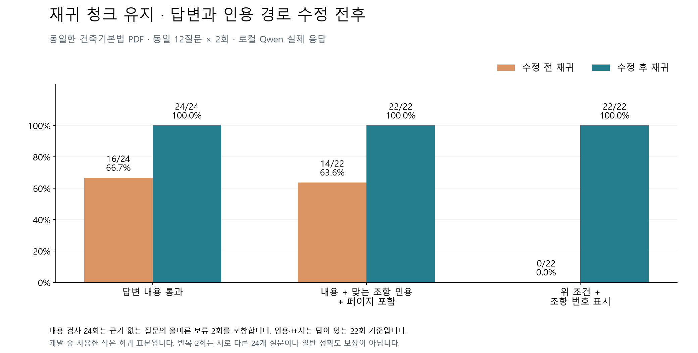
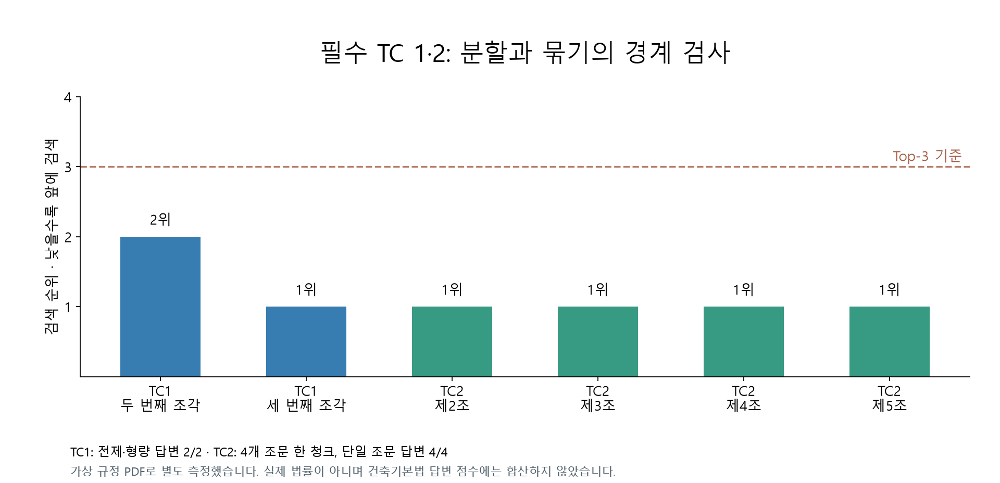

# 재귀 청크·인용·복합 질문 수정 전후

2026-10-15. 원본 PDF SHA-256: `b25f8073d1ecbb1dc268f322593e444af5cdf524aa2beee2d8949206c248ce11`.
이전 `pdf-ab-20261015`의 재귀 결과와 수정 후 `completed`를 비교한다. 모델·토큰 설정·12질문은 동일하다.
청크는 두 버전 모두 34개, 최대 381/384토큰이다. 이 파일에서는 짧은 조문 packing 조건에 맞는 묶음이 없어 경계가 그대로다.
이번 차이는 질문 분해·검색 문맥·프롬프트·인용 선택·검증 변경의 합산 효과다. 개별 변경의 효과를 분리한 실험은 아니다.

| 지표 | 수정 전 | 수정 후 |
|---|---:|---:|
| 답변 내용 + 올바른 보류 | 16/24 | 24/24 |
| 내용 + 맞는 조항 원문 인용 + 페이지 포함 | 14/22 | 22/22 |
| 위 조건 + 조항 번호 표시 | 0/22 | 22/22 |
| 잘못된 확정 답변 | 1 | 0 |
| 답이 있는데 보류 | 7 | 0 |

실제 출력의 인용 28개를 저장 Markdown과 페이지 구간에 다시 대조했다.
원문 일치·조항·항 번호·인용문별 PDF 페이지가 모두 맞았다. 파일 링크의 page는 청크 범위이고,
`위치:`는 개별 인용문 범위라 서로 다를 수 있다. 제14조의 전제는 3쪽, 7호는 4쪽으로 각각 표시한다.
명시적으로 조·항·페이지를 요청한 추가 2질문도 2/2 통과했다.

| 사용자 필수 사례 | 결과 |
|---|---|
| TC 1 | 초대형 제1조 5개 청크. 두 번째·세 번째 조각 순위 2, 1. 전제·형량 답변 2/2 |
| TC 2 | 제2~5조 네 개 한 청크: True. 단일 조문 Top-3 4/4, 내용 답변 4/4 |

TC 자료는 [테스트 전용 가상 PDF](../../../artifacts/evaluations/pdf-citations-20261015/stress/stress.pdf)다. 제공 법률에 없는 초대형 벌칙을 있는 것처럼 가정하지 않았다.
초기 TC 1에서 형량은 맞지만 다른 호를 인용한 사례를 발견하여, 최종 판정에는 대상명이 실제 인용문에 있는지 추가했다.
두 번째·세 번째 청크에만 존재하고 첫 청크에는 없는 대상명을 골라 확인했다.
가상 문서는 7청크, 최대 381토큰, 제목 전용 0개, 원문 포함률 100%다.
자동 회귀는 545개, 실패 0개·오류 0개다. 기존 실제 모델 17질문은 17/17 통과했다.

## 확인할 파일

- [질문별 그래프](../../../artifacts/evaluations/pdf-citations-20261015/questions.png), [실제 답변 전체](answers.md), [인용 원문 대조](../../../artifacts/evaluations/pdf-citations-20261015/validation.json)
- [PDF 최종 원시 기록](../../../artifacts/evaluations/pdf-citations-20261015/completed/report.json), [명시적 출처 요청](../../../artifacts/evaluations/pdf-citations-20261015/completed/explicit-citations.json)
- [TC 1·2 검색·원본 답변](../../../artifacts/evaluations/pdf-citations-20261015/stress/unique-tail/report.json), [기존 17질문 회귀](../../../artifacts/evaluations/pdf-citations-20261015/r3-completed/answer_report.json)
- [이전 비교 원본](../pdf-ab-20261015/REPORT.md), [수정 과정의 실패 기록](../../../artifacts/evaluations/pdf-citations-20261015/pilot2/report.json)

## 해석과 재현

개발에 사용한 작은 회귀 표본이며 12질문을 두 번 실행했다. 새로운 24질문의 일반 정확도 측정이 아니다.
답변 내용은 기준 사실·조항별 핵심 구절을 검사하고 실제 출력을 검토했다. 인용 위치 검사는 저장된 원문 구간과 독립적으로 대조했다.
같은 Qwen 모델의 검증은 의미 오류를 완전히 차단하는 보장이 아니며 임의의 복합문장이나 OCR PDF는 별도 범위다.
실행 시간은 모델 준비·동시 로컬 작업 영향이 있어 이번 비교 지표에서 제외했다.

`completed/compare.py`는 새 출력 폴더에 복사해 실행한다. 기존 report.json을 덮어쓰지 않는다.
`stress_verified.py`도 출력 경로를 바꿔 실행한다. Python 경로에 저장소 루트를 넣고 로컬 Ollama와 설치된 모델을 사용한다.
`summarize.py`는 원본/질문/현재 소스 해시를 검사한 다음 그래프와 인용 대조를 만든다.
