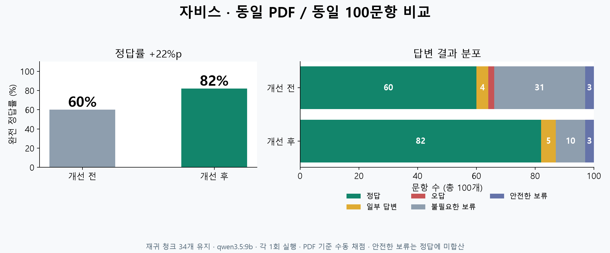

# RAG 답변 품질 개선 — 100문항 후속

## 변경 이유와 기준

2026-10-15 기준 건축기본법 PDF 100문항은 완전 정답 60, 일부 답변 4,
오답 2, 답할 수 있으나 보류 31, 안전한 보류 3이었다.
법률 번호/참조 조문을 인용 위치로 오인하는 검사, 질문 단어 일치 검사,
복합 질문 누락과 전체 구조 집계 부재를 확인했다.
이전 결과는 `artifacts/evaluations/pdf-100-questions-20261015`에 보존한다.

## 적용 순서

1. 인용 위치·본문 참조·법률 번호를 구분하고 단어 검사 오판을 줄인다.
2. 질문별 누락을 검사하고 긴 목록의 답변·인용 상한을 보완한다.
3. 장·조·항 목록과 개수, 문서 전체 질문에 구조 기반 조회를 추가한다.
4. 동일 조문·참조 조문의 문맥을 제한된 범위에서 보강한다.
5. 주체·의무·조건의 의미 검사를 강화하고 PDF 한정 질문의 일반 답변 전환을 막는다.
6. 같은 자료·모델 조건으로 100문항을 다시 측정해 검색/생성/검증 실패를 구분한다.

재귀 청크 정책과 저장된 임베딩은 유지한다. 특정 법률명·질문 번호·참고 정답을
실행 코드에 넣지 않는다. 본문 정확 인용, 출처/페이지 검증, 로컬 전용 자료 정책,
예산·입력 상한과 보류 기능을 유지한다. 검증을 완화해 오답을 통과시키는 것을
정답률 개선으로 취급하지 않는다.

## 무엇을 왜 바꿨는가

| 순서 | 적용한 변경 | 이유 |
|---|---|---|
| 1 | 생성 모델이 source_id와 정확한 원문을 선택하고 앱이 ID·조항·페이지를 연결 | 맞는 설명에 옆 문단의 인용 ID를 붙이던 오류를 줄인다 |
| 1 | 법률 번호, 본문의 참조 조항, 인용 위치의 숫자를 구분 | 법률 번호나 참조 조문이 들어간 정답을 잘못 거부하지 않는다. 조문 번호로 임기 등을 정당화하는 것은 계속 거부한다 |
| 2 | 분리 가능한 복합 질문은 각각 검색·생성·검증; 주장과 인용 상한 16개 | 앞 질문만 답하거나 긴 목록을 4개에서 끊는 문제를 줄인다 |
| 3 | 전체 Markdown의 장·조·항 구조 조회, 호·장·본문 조문 계수 | Top-k 일부 청크만 보고 전체 개수를 추측하지 않는다 |
| 4 | 동일 조문의 다른 조각·목록 전제·직접 참조한 항 보강 | 뒤쪽 청크만 검색돼 주체와 전제 조건을 잃는 문제를 줄인다 |
| 4 | 전체 주기·의무 질문은 관련 원문 구간을 선택해 전달 | 문맥을 보강해도 기존 입력 예산을 초과하지 않게 한다 |
| 5 | 의무 대상 확대 차단·유일한 원문 의무 절 교정, PDF 전용 경로 | 요청 가능한 대상과 반드시 따라야 하는 대상을 구분하고 외부 지식으로 빈칸을 채우지 않는다 |

청킹은 문서를 저장할 때 한 번 수행한다. 이번 `focus_evidence`는 질문 시 저장 청크에서
모델에 보여줄 원문 구간을 선택하는 단계다. 새 청크나 새 임베딩을 만드는 기능이 아니다.
기존 keyword/vector RRF·다국어 reranker도 유지했다. 일반 검색 문맥은 6개, 구조 질의는
`rag.max_structured_chunks` 기본 16개까지 후보를 보강하지만 입력 예산은 그대로 적용한다.

장·조문·호 개수와 전체 '년마다'·여백 질의는 제한된 구조/추출 초안을 사용한다.
초안도 원문·위치·숫자·의미 검증을 통과해야 출력한다. 질문 번호나 참고 정답으로 답을
선택하지 않는다. 여백 출처는 `#structure`로 표시하고 법률 본문과 구분한다.
실제 인터페이스는 [DESIGN](../DESIGN.md), [SCHEMAS 13.5~6](../SCHEMAS.md)에 기록했다.

## 동일 PDF·100문항 결과

| 수동 판정 | 이전 | 개선 후 |
|---|---:|---:|
| 완전 정답 | 60 | **82** |
| 일부 답변 | 4 | 5 |
| 오답 | 2 | 0 |
| 불필요한 보류 | 31 | 10 |
| 안전한 보류 | 3 | 3 |

완전 정답률 **60% → 82%, +22%p**. 새 정답 29개, 기존 정답에서 하락 7개다.
하락 문항은 2·23·48·64·68·74·93번이며 모두 보고서에 남겼다.
‘일부 답변’에는 누락과 부정확한 허용 표현을 포함하므로 오답 0개를 모든 응답의 무오류로
해석하지 않는다. 앱 자체 ‘근거 확인’은 87개지만 수동 완전 정답은 82개다.

- 같은 6쪽 PDF와 원본 질문 100개를 각 새 세션에서 1회 실행했다. 이전 보고서를 덮어쓰지 않았다.
- qwen3.5:9b, temperature 0.3, 입력 12,288/출력 2,000 예산, 임베딩·reranker 설정은 같았다.
- PDF·질문 SHA-256, Markdown, 청크 본문·offset·토큰 수·페이지·구조가 이전과 일치한다.
- 재귀 v4 **34청크, 최대 381토큰**, 개발 DB의 **34개 768차원 벡터 해시도 동일**하다.
- 실제 인용 178건의 원문·조항·페이지 검사 실패 **0건**. 제목은 Markdown, 제거 여백은 원본 추출 메타데이터와 대조했다.
- 실행 오류·임베딩 오류·reranker 오류 0건. 실행 시간은 626.9초 → 671.1초(각 1회 측정)다.

이 자료와 질문은 개발 중에도 확인한 표본이다. 다른 문서의 일반 성능이나 독립 holdout
평가가 아니며 반복 실행 평균도 아니다. 파일럿 4회는 문제 진단용이고 최종 100문항 점수에
섞지 않았다. 최종 실행 동안 소스를 고정했고 기존 `references.py` 채점 기준을 변경하지 않았다.
96~98번의 안전한 보류는 이전처럼 완전 정답에 합산하지 않았다.

## 검증과 적용 상태

`implemented_verified` — 이 후속 범위의 구현·회귀·실제 PDF 평가 완료, 정식 릴리스와 별개다.

- Phase 0~3 및 security marker 회귀 **568개 통과**. XML은 `regression-final.xml`이다.
- 변경한 소스/테스트 Ruff 검사 통과. 전체 mypy에는 이번 범위 밖 음성·GUI의 오류 7개가 남아
  전체 타입 검사를 통과했다고 표시하지 않는다. RAG 변경 파일의 보고 오류는 없다.
- 설정 예제 모델 검증, 문서 상대 링크·JSON 블록 검사를 통과했다.
- 개발 DB는 읽기 전용으로 확인했고 원본 문서·벡터·세대를 변경하지 않았다.
- 루트 `Jarvis.exe`의 런처 소스는 같은 폴더 `.venv`로 `-m app --gui`를 실행한다.
  현재 실행 중인 앱은 재시작하면 이 소스를 읽는다. 이번에는 GUI를 강제로 종료하지 않았으며
  EXE 재빌드·배포·실장치 음성 인수를 수행하지 않았다. 기존 v4 PDF의 재색인은 필요 없다.

## 남은 문제와 다음 개선 지점

일부 답변 5개는 2번 전화번호 누락, 62번 두 번째 요청 누락, 64번 광역위원회 정식 명칭 누락,
79번 ‘공고할 수 있다’ 표현 약화, 93번 지역계획 누락이다. 불필요한 보류 10개는
23·40·48·50·55·58·61·68·74·80번이다. 다음에는 요구 속성을 명시적으로 나누고 각 속성의
답변·인용 여부를 확인하는 완전성 검사와 단어 검사 오판을 개선할 필요가 있다.

구조 조회는 최상위 PDF 한 문서, 최대 2048청크/128개 제목/16개 문맥으로 제한한다.
복합 질문 분해와 같은 문서의 참조 해석은 제한된 패턴이며 모든 자연어·교차 법령을 해결하지
않는다. 전체 주기 추출은 답의 조건을 보존하지만 문장이 길고 PDF 줄바꿈이 남는다.
미지 문서·다른 질문의 추가 평가, 반복 측정, 전체 문서의 누락 보장과 표현 정리가 후속 과제다.

[100문항 실제 답변·이전 결과 비교](../../artifacts/evaluations/pdf-100-improved-20261015/report.html) ·
[비교 수치](../../artifacts/evaluations/pdf-100-improved-20261015/comparison.json) ·
[원본 실행](../../artifacts/evaluations/pdf-100-improved-20261015/report.json) ·
[검증 기록](../../artifacts/evaluations/pdf-100-improved-20261015/validation.json) ·
[회귀 XML](../../artifacts/evaluations/pdf-100-improved-20261015/regression-final.xml)
