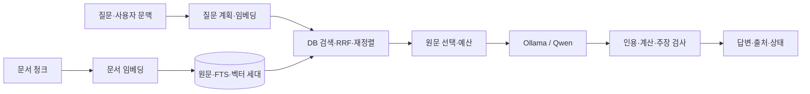

# R3 구현 결과와 구조 설명 — 2026-10-14

> 이 문서는 2026-10-14 `context-v1` 구현·측정 기록이다. 2026-10-15 문서/질문 경로와
> `recursive-context-v2` 변경은 [재귀 청크 적용 보고](RAG_RECURSIVE_CHUNKING.md)를 따른다.
> 아래 수치를 새 청크 정책의 평가 결과로 재사용하지 않는다.

R3-01부터 순서대로 R3-07까지 구현하고 R3-08의 자동 평가·운영 문서를 적용했다.
새 어텐션 층을 만드는 작업이 아니라, 기존 embeddinggemma·Qwen 사이의 자료 처리와 검색·검증을 바로잡았다.
실장치 음성·GUI와 정식 릴리스 인수는 아직 완료하지 않았다.

## 1. 어디를 왜 바꿨나

| 순서 | 변경 | 이유 | 주요 파일 |
|---|---|---|---|
| R3-01 | 원 질문/검색 질문 분리, 사용자 발화로 후속 질문 구성 | “그럼 어디에서?”만 검색하면 대상을 잃음 | [query_plan.py](../../scripts/app/orchestrator/query_plan.py) |
| R3-02 | 질문/문서 입력 접두사, digest·형식 버전 격리 | 역할에 맞는 표현을 만들고 옛 벡터 혼합 방지 | [local_embedder.py](../../scripts/app/rag/local_embedder.py) |
| R3-03 | 제목·문단/줄 경계와 실제 임베딩 토큰 한도 청크 | 문자 수만으로 문맥·토큰 한도를 보장할 수 없음 | [chunker.py](../../scripts/app/rag/chunker.py) |
| R3-04 | 설정 fingerprint, prepared/active 세대와 사본 복구 | 같은 파일의 설정 변경 누락과 원문/벡터 엇갈림 해결 | [generations.py](../../scripts/app/rag/generations.py), [indexer.py](../../scripts/app/rag/indexer.py) |
| R3-05 | 긴 후보 구간별 재정렬, 이웃 원문, 중복 제거·입력 예산 | 후보 뒤쪽 정답·여러 조항 누락 방지 | [reranker.py](../../scripts/app/rag/reranker.py), [research.py](../../scripts/app/orchestrator/research.py) |
| R3-06 | 근거/일반/보류 답변 분기·화면/음성 표시·저장 모드 | 일반 지식 답변과 회사 사실 추측 구분 | [loop.py](../../scripts/app/orchestrator/loop.py), [response_presenter.py](../../scripts/app/orchestrator/response_presenter.py) |
| R3-07 | 인용 피연산자·단위·허용 연산 재계산 | 문서의 5일+3일을 8일로 답할 수 있게 함 | [grounding.py](../../scripts/app/rag/grounding.py) |
| R3-08 | 합성 장문/후속 질문/계산/일반 답변 평가, 변경·장애 회귀 | 코드 계약과 실제 모델의 동작을 각각 검증 | [answers.py](../../scripts/app/rag/benchmark/answers.py), [redesign.py](../../scripts/app/rag/benchmark/redesign.py) |

친숙한 질문으로 과정을 따라가려면 [Phase 3 상세 설명](../phase-03-research/DETAIL.md)을 읽는다.
정확한 설계는 [DESIGN 16장](../DESIGN.md#16-rag검색-계약), 데이터 계약은 [SCHEMAS 13장](../SCHEMAS.md)에 있다.

## 2. 실제 실행 흐름

모델 내부에서 ID·토큰 벡터·위치 정보·어텐션·feed-forward가 계산된다. DB는 그 모델 내부와 별개다.
검색이 벡터에서 원문 위치를 찾으면 Qwen은 **원문**을 읽는다. 일반 지식 폴백만 문서 출처 없이 답하고 이를 표시한다.

## 3. 검증 결과

| 검증 | 결과 | 근거 |
|---|---|---|
| Phase 0~3·security 직접 pytest | 488 passed, 260 deselected | [JUnit](../../artifacts/evaluations/rag-r3-20261014/phase3-regression.xml) |
| 전체 비네트워크·비slow pytest | 728 passed, 8 setup errors, 12 deselected | [JUnit](../../artifacts/evaluations/rag-r3-20261014/full-regression.xml) |
| 실제 Qwen 답변 평가 | 17/17 통과 | [최종 JSON](../../artifacts/evaluations/rag-r3-20261014/answers-final/answer_report.json) |
| 실제 검색 비교 | 11질의, 세 토큰 상한 모두 Hit@1=9/11·Hit@5=11/11 | [최종 JSON](../../artifacts/evaluations/rag-r3-20261014/retrieval-final/retrieval_report.json) |
| 역할별 입력 비교 | 동일 384토큰 청크에서 raw-v1/search-v1 모두 9/11·11/11 | 같은 검색 보고서; 정확도 개선을 입증한 결과 아님 |
| 로컬 실행 환경 | Qwen digest, embeddinggemma 768, FTS5/sqlite-vec, ONNX 추론 정상 | [진단 JSON](../../artifacts/evaluations/rag-r3-20261014/runtime.json) |
| 수정 Python 파일 Ruff | 통과 | 변경 파일 범위 검사 |
| RAG·query_plan mypy | 26개 소스 통과 | 전체 mypy는 기존 음성·GUI 오류 7개가 남음 |
| 정식 gate.py --phase 3 | 실행 거부 | 기존 미커밋 변경 포함 작업 트리가 깨끗하지 않음 |

전체 테스트의 8개 오류는 기존 PC 실행 테스트 3파일의 Sandbox 생성 인자 누락이다.
작업 전 사본에서도 같은 8개 오류를 재현했다. 해당 PC 코드·테스트를 이번 RAG 변경에서 수정하지 않았다.
전체 mypy의 음성·GUI 7개 오류 역시 수정 범위 밖에 남아 있다. 정식 릴리스 성공이라고 표시하지 않는다.

실제 답변 사례: 정답 가능 6, 근거 없음 4, 상충 2, 문서 인젝션 1, 후속 질문 1,
긴 문서 1, 인용 계산 1, 일반 지식 1. 평균 약 3.45초, P95 약 7.52초였다.
후속 질문 사례의 시간은 선행 질문 처리도 포함하며 첫 사례는 모델 적재 영향이 있다.
작은 개발 회귀 세트이고 고정 사실 문자열로 채점한다. 실무 정확도나 모든 악성 문서 방어를 보장하지 않는다.

첫 평가 15/17에서 계산식 생략과 올바른 규정 답변의 과도한 보류를 발견했다.
생성 JSON에서 calculations를 필수로 하고 의미를 보존하는 띄어쓰기·의무 표현을 허용한 뒤 17/17을 재확인했다.
초기 [실패 기록](../../artifacts/evaluations/rag-r3-20261014/answers/answer_report.json)을 남겼다. 검증 호출을 없애거나 실패 답을 강제 승인하지 않았다.
검색의 초기 retrieval/retrieval-v2 보고서는 Windows 경로 구분자 채점 오류가 있어 품질 근거로 쓰지 않는다.
`retrieval-final`만 수정된 채점 결과다. 과거 `rag-current-20261014` 보고서도 덮어쓰지 않았다.

## 4. 기본값과 운영 적용

개발 기본값은 청크 384/겹침 48토큰, 보조 1200/150자, 이웃 반경 1, 문서당/전체 최대 6청크다.
256/384/512 비교는 72/69/67청크였고 토큰 상한을 지켰다. 품질이 같으므로 384가 최적이라고 주장하지 않는다.
초기 색인 시간은 모델 캐시와 실행 순서 영향을 받으므로 설정 간 순수 속도 비교로 해석하지 않는다.
설정 모델·예제를 갱신했으며 기존 운영 YAML의 명시값과 운영 데이터 DB는 바꾸지 않았다.

1. 실행 중인 자비스를 종료하고 다시 실행해 수정된 소스를 읽게 한다.
2. `/index`로 새 정책의 세대를 준비한다. 실패하면 오류를 확인하고 모델 복구 후 다시 실행한다.
3. 문서 질문과 후속 질문, 근거 없는 내부 질문과 일반 질문의 표시를 확인한다.
4. 설정 파일 변경은 재시작 후 `/index`; 파일 변경은 다음 주기 확인 또는 `/index`로 반영한다.

문서 전체·FTS·벡터는 주 DB에서 같은 세대로 전환한다. semantic DB는 generation marker로 복구하는 사본이다.
직전 세대 하나는 남기지만 파일 삭제가 있으면 이전 세대를 제거한다. 임의 DB 삭제로 재색인을 강제하지 않는다.
상시 파일 watcher는 없고, 검색 시 마지막 검사 후 5초가 지나면 파일 해시를 다시 확인한다.
마이그레이션은 합성 DB로 검증했으며 사용자 운영 DB를 이번 평가에서 강제 전환하지 않았다.

## 5. 확인된 제한·남은 인수

- QueryPlan은 규칙 기반이며 모든 말투·주제 전환을 이해하는 의미 모델은 아니다.
- 문서 청크는 제목/문단/줄 경계를 사용하지만 PDF·Office·OCR, 복잡한 표/코드 의미 해석은 지원하지 않는다.
- 임베딩 토큰 계수는 실제 모델 결과, 생성 토큰 사전 계수는 UTF-8 바이트 기반 보수적 추정이다.
- 정확 코사인 전수 검색과 5초 주기의 파일 해시 비용은 남는다. 대규모 부하·동시 사용자 평가는 하지 않았다.
- 같은 Qwen의 검증이므로 독립 사실 검증은 아니다. 일반 답변과 과거 대화는 검증된 문서로 자동 등록하지 않는다.
- UI/음성 출력의 코드 계약은 자동 테스트했지만 물리 마이크·스피커, GUI 시각 인수는 하지 않았다.
- 깨끗한 작업 트리의 정식 게이트, 깨끗한 Windows 설치, 백업 복원 인수, 7일 안정화는 별도다.

재현 명령과 새 테스트 연결은 [TESTING 13장](../TESTING.md), 상태는 [PROGRESS](../PROGRESS.md)를 따른다.
