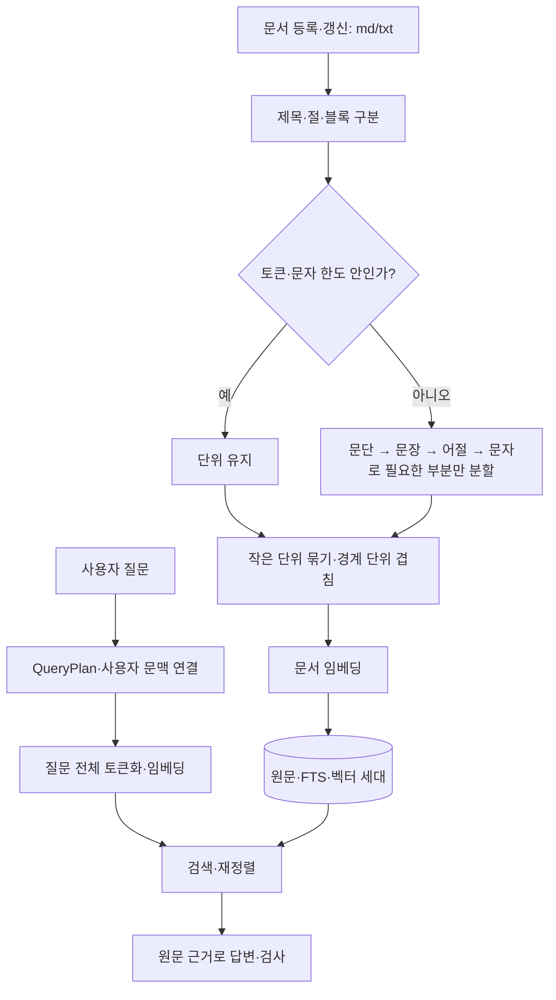

# 문서/질문 경로와 재귀 청크 적용 — 2026-10-15

사용자가 요청한 목적별 처리와 토큰 제한 재귀 청크를 R3-02·03·04의 후속 변경으로 적용했다.
계약은 [DESIGN 16장](../DESIGN.md), 저장은 [SCHEMAS](../SCHEMAS.md),
검증 규약은 [TESTING 13.4](../TESTING.md), 설명은 [Phase 3 DETAIL](../phase-03-research/DETAIL.md)에 반영했다.

## 무엇을 왜 바꿨나

| 부분 | 이전 | 적용 후와 이유 |
|---|---|---|
| 문서와 질문 | 별도 호출 경로는 있었지만 계약이 불명확 | 문서 `document_chunks`와 질문 `embed_query/query_input` 진입점 명시; 긴 질문도 문서로 취급하지 않음 |
| 문서 분할 | 제한 안의 마지막 경계 선택 | 큰 부분만 문단→문장→어절→문자로 재귀 분할; 들어가는 다음 문단 보존 |
| 작은 단위 | 길이 창에 맞춤 | 같은 절에서 합치고, 짧은 단일 절 문서는 한 청크로 유지 |
| 겹침 | 문자 수 기준 시작점, 어절 중간 가능 | 완전한 마지막 분할 단위만 사용; 다음 단위를 보존하려면 겹침 축소/생략 |
| 표·코드 | 줄 경계 후보 | 들어가는 단순 표·목록·fenced code 블록은 보존, 초과 시 줄부터 분할 |
| 색인 갱신 | `context-v1` | `recursive-context-v2`를 fingerprint에 반영해 같은 파일도 한 번 재색인 |
| 질문 입력 | query 접두사로 전체 입력 | 계약 유지·명시 및 긴 질문 끝 조건 보존/청크 미호출 회귀 추가 |

## 두 경로



입력 목적을 먼저 구분한다. 긴 질문이라는 이유로 문서 splitter에 보내지 않는다.
재귀 분할은 경계를 고르는 방법이며, 토큰 수는 크기 기준이다. 모든 모델 입력에는 토큰화가 필요하다.
새 FSM 엔진은 추가하지 않았다. 단계별 원자 게시/실패 복구는 기존 색인 세대를 사용한다.

## 계약과 제한

- 기본 문서 청크 384토큰, 겹침 최대 48토큰; 보조 상한 1200/150자 유지. 접두사·제목도 포함한다.
- 모델 사용 시 `prompt_eval_count`로 검사한다. 토큰 측정은 임베딩 호출이므로 최초 색인 비용이 있다.
- 측정 요청 자체의 모델 문맥 한도 초과는 더 작게 나눌 신호로 처리한다. 드문 유니코드 반복 문서로
  재현한 HTTP 400을 `EmbeddingInputTooLong`으로 구분했으며, 연결 장애·다른 오류는 숨기지 않는다.
- 모델 없는 어휘 전용 색인은 문자 제한만 적용하고 `token_count=null`로 명시한다.
- 절을 넘겨 합치거나 겹치지 않는다. 원문 문자열과 문자 위치를 그대로 보존한다.
- 어절은 공백 경계이며 형태소 분석이 아니다. 문장 경계는 구두점 규칙이며 완전한 언어 분석기가 아니다.
- 단순 표는 `|`로 시작하는 줄 기준이다. 아주 긴 표 행/코드 줄은 어절·문자까지 분할될 수 있다.
  표 헤더 복제, 복잡한 표의 의미 해석, 완전한 Markdown AST 파서는 추가하지 않았다.
- 질문은 한 번의 전체 입력이다. 모델 한도를 넘으면 truncate=false로 실패하고 검색 오류로 처리한다.
  긴 질문의 첨부 자료 분리·하위 질문 자동 생성은 별도 기능이다.
- PDF→Markdown/OCR은 구현하지 않았다. 기존 UTF-8 md/txt 입력을 개선한 변경이다.

## 검증

최종 코드의 검증 결과다. 이전 R3 결과를 새 정책의 성능으로 사용하지 않는다.

| 검증 | 결과 | 증거 |
|---|---|---|
| 청크·역할 입력·세대 집중 회귀 | 45 passed | test_contextual_chunks, test_local_embedder, test_index_generations |
| Phase 0~3·security, 비네트워크·비slow | 513 passed, 260 deselected | [JUnit](../../artifacts/evaluations/rag-recursive-20261015/phase-regression-final.xml) |
| 수정 Python Ruff / RAG·query_plan mypy | 통과 / 26소스 통과 | 아래 재현 명령 |
| 실제 로컬 답변 | 17/17, 평균 3354ms, P95 6567ms | [답변 보고](../../artifacts/evaluations/rag-recursive-20261015/answers-final/answer_report.json) |
| 실제 검색 11질의 | 256/384/512 모두 Hit@1=9/11, Hit@5=11/11 | [검색 보고](../../artifacts/evaluations/rag-recursive-20261015/retrieval-verified/retrieval_report.json) |
| 실제 토큰 상한 | 256→최대244, 384→384, 512→504; 청크73/69/67 | 같은 검색 보고 |
| 드문 유니코드·한국어·이모지 반복 | 1200/3000/1500문자 전부 보존, 최대381/384/384토큰 | [Unicode 검사](../../artifacts/evaluations/rag-recursive-20261015/unicode-smoke.json) |

문단 보존과 경로 계약의 개선을 확인했지만, 작은 합성 세트의 검색 점수는 이전과 같다.
일반적인 정확도 향상이나 384토큰의 최적성을 주장하지 않는다. 물리 UI/음성 인수·정식 릴리스는 별도다.
이번에는 전체 Phase 4~8 테스트를 반복 실행하지 않았다. 이전 전체 회귀의 기존 오류는 10월 14일 보고에 남아 있다.

최초 `retrieval/` 실행은 Ollama 미실행으로 중단됐다. 로컬 서버 실행 후 재평가했으며,
문맥 초과 처리를 보완한 최종 증거는 `retrieval-verified/`, `answers-final/`이다.
각 보고서에 소스 SHA-256·자료/모델 정보를 보존하고 최종 파일과 일치하는지 검사한다.

```powershell
$env:PYTHONUTF8='1'
.\.venv\Scripts\python.exe -m pytest -m "(phase0 or phase1 or phase2 or phase3 or security) and not allow_network and not slow" --tb=short
.\.venv\Scripts\python.exe -m ruff check scripts/app/rag/chunker.py scripts/app/rag/generations.py scripts/app/rag/indexer.py scripts/app/rag/local_embedder.py scripts/tests/unit/test_contextual_chunks.py scripts/tests/unit/test_index_generations.py scripts/tests/unit/test_local_embedder.py
.\.venv\Scripts\python.exe -m mypy scripts/app/rag scripts/app/orchestrator/query_plan.py --follow-imports=silent
.\.venv\Scripts\python.exe -m app.rag.benchmark.redesign --config-dir D:\Jarvis-v2-dev\config --output-dir artifacts/evaluations/rag-recursive-rerun/retrieval
.\.venv\Scripts\python.exe -m app.rag.benchmark.answers --config-dir D:\Jarvis-v2-dev\config --dataset scripts/tests/data/rag_r3_answers.json --output-dir artifacts/evaluations/rag-recursive-rerun/answers
```

평가는 새 출력 폴더를 사용하며 운영 DB를 읽지 않는다. 아래 개발 DB 적용과 구분한다.

## 적용

개발 DB `D:\Jarvis-v2-dev\memory\jarvis.sqlite3`에 새 정책의 세대 전환까지 적용했다.
기존 문서 20개는 모두 짧아 각 한 청크로 유지됐다. 최대 123토큰, 미측정 청크 0개,
준비/게시 오류 0개, SQLite integrity_check=ok, 두 번째 sync의 갱신 0개를 확인했다.
원문·대화 백업은 `D:\Jarvis-v2-dev\backups\recursive-20261015-3d46a951`에 보존했다.
재현 스크립트와 집계 증거는 [runtime-application.json](../../artifacts/evaluations/rag-recursive-20261015/runtime-application.json)에 있다.

실행 중인 앱의 소스는 재시작해야 바뀐다. 색인 정책 버전이 바뀌면 시작 시 sync 또는 `/index`에서
기존 원문·FTS·벡터를 새 세대로 교체한다. 준비 실패 시 이전 완전한 세대를 유지한다.
새 YAML 키나 DB 열은 필요하지 않으며 기존 설정의 명시값을 사용한다.
